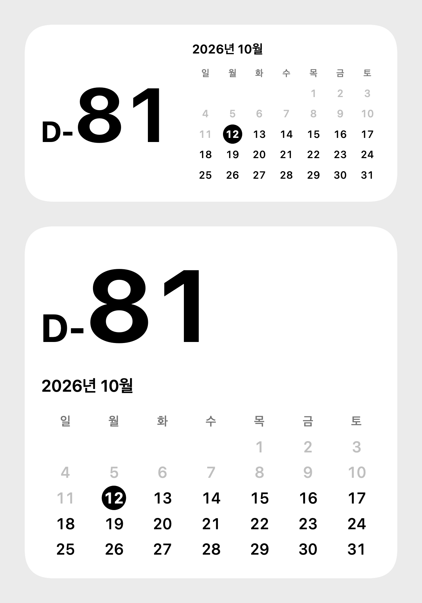

# 2027

2027년 1월 1일까지 남은 날짜와 이번 달 달력을 보여주는 iPhone 홈 화면 위젯.

- 흰색 배경에 검정·회색만 사용
- 남은 날짜는 `D-81` 형식으로 표시하고 `D-`는 작게, 숫자는 큰 볼드로 표시
- 지난 날짜는 흐린 회색, 오늘은 검정 원으로 강조
- 기본 산세리프 서체 및 왼쪽 정렬
- 중형(2단계)·대형(3단계)·iOS 27 초대형 세로(4단계) 위젯 지원
- 위젯을 누르면 카운트다운·달력을 전체 화면으로 표시
- 기기 현지 시간대의 자정을 기준으로 날짜 계산 및 일주일치 위젯 타임라인 생성
- 목표일 이후는 `0` 표시



## 홈 화면에 추가

앱 설치 후 홈 화면의 빈 공간을 길게 누르고 **편집 → 위젯 추가 → 2027**을 선택한다. 원하는 크기를 선택해 추가한다. iOS 홈 화면 위젯 배치는 사용자가 직접 수행한다. 흰색 배경을 유지하려면 홈 화면 아이콘 스타일을 기본/라이트로 사용한다. iOS의 틴트 스타일은 시스템에서 위젯 색상을 변경할 수 있다.

## 개발

Xcode 26.3에서 빌드 검증. iOS 17 이상 지원.

`NewYear2027.xcodeproj`를 Xcode에서 열고 Signing & Capabilities에서 개인 개발 팀을 선택해 실제 iPhone으로 실행한다. 설치에는 유효한 Apple 개발 계정과 프로비저닝이 필요하다.

프로젝트 재생성:

```sh
brew install xcodegen
xcodegen generate
```

연결한 기기에 설치 및 실행:

```sh
xcrun devicectl list devices
./scripts/install-device.sh <iPhone-UDID>
```

Xcode가 iOS 플랫폼 구성요소가 없다고 표시하면 **Xcode → Settings → Components → iOS → Get**으로 설치한다. 개인 팀 프로비저닝은 유효기간이 짧으므로 만료 후 같은 명령으로 재설치한다.

날짜·시간대·월 경계 검증:

```sh
./scripts/check.sh
```

서명 없이 iPhone 대상 빌드 검증:

```sh
xcodebuild -project NewYear2027.xcodeproj -target NewYear2027 \
  -sdk iphoneos -configuration Debug CODE_SIGNING_ALLOWED=NO \
  SYMROOT="$PWD/build/unsigned" build
```

macOS에서 공유 SwiftUI 화면 미리보기 생성:

```sh
swiftc Shared/CountdownModel.swift Shared/CountdownView.swift scripts/Preview.swift -o /tmp/2027-preview
/tmp/2027-preview /tmp/2027-preview.png
```

## 작업 관리

`td init --store=gh-issue`로 GitHub Issues 저장소를 사용한다. `td task list`로 작업 상태를 조회한다.

WidgetKit 타임라인과 배경은 [Apple WidgetKit 문서](https://developer.apple.com/documentation/widgetkit/creating-a-widget-extension) 및 [위젯 배경 문서](https://developer.apple.com/documentation/widgetkit/displaying-the-right-widget-background)를 기준으로 구현했다.

## Xcode에서 미리보기와 편집

1. 중형·대형은 `Widget/WidgetPreviews.swift`, 초대형·전체 화면은 `Shared/CountdownView.swift`를 연다.
2. **Editor → Canvas** (`⌥⌘↩`)를 켜고, 미리보기가 일시 정지되어 있으면 **Resume** (`⌥⌘P`)을 누른다.
3. 각 파일의 Canvas에서 원하는 미리보기를 선택한다. 초대형·전체 화면은 앱과 공유하는 View 파일에서 미리보기로 제공한다.
4. 미리보기의 핀 버튼으로 화면을 고정한 뒤 `Shared/CountdownView.swift`를 열어 글자 크기, 색상, 간격, 정렬을 수정한다. Canvas에서 결과를 확인한다.

`previewDate`를 바꾸면 다른 날짜와 달의 표시를 확인할 수 있다. 실제 날짜 계산은 `Shared/CountdownModel.swift`, 지원 크기는 `Shared/WidgetSizes.swift`, 전체 화면 앱은 `App/CountdownApp.swift`에서 수정한다.

설치된 iOS 26 시뮬레이터에서 4단계는 레이아웃 미리보기다. iOS 27 초대형 위젯의 실제 시스템 크기는 iPhone에서 확인한다. 수정사항을 기기에 반영하려면 iPhone을 실행 대상으로 선택하고 **Run** (`⌘R`)으로 재설치한다.
